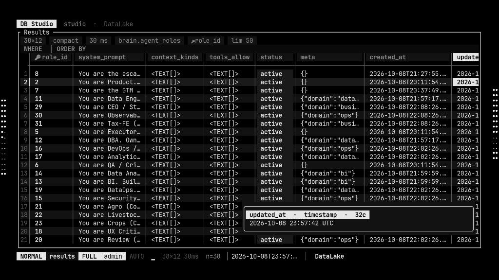
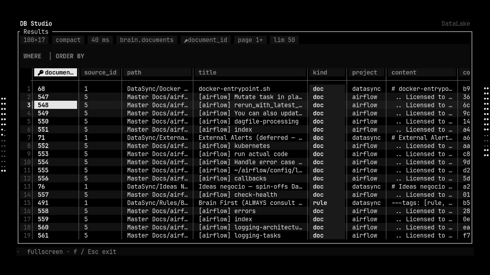
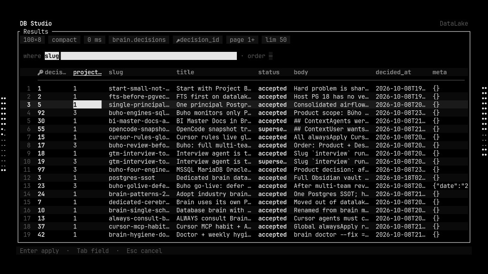
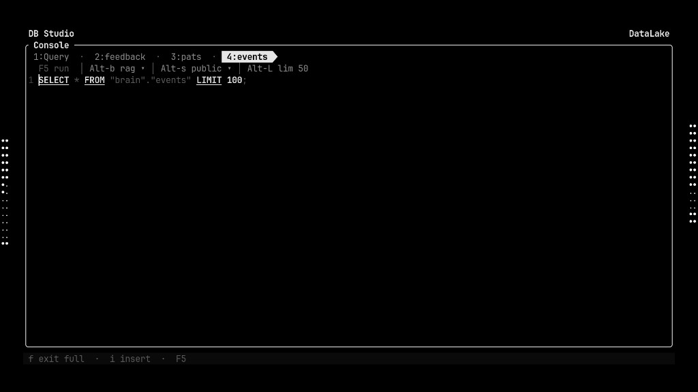
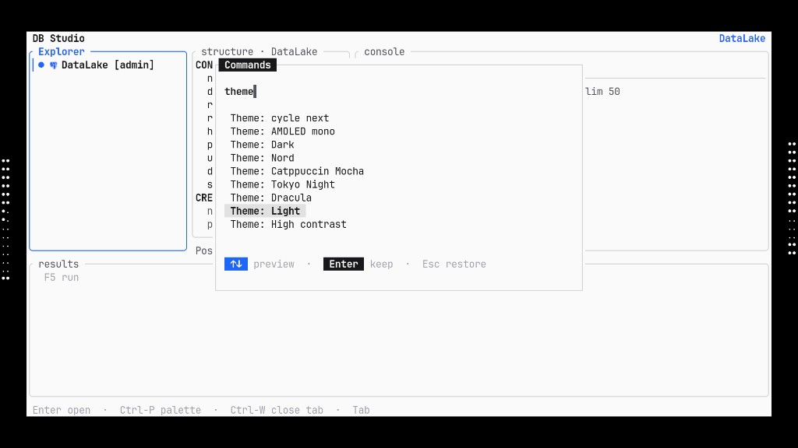
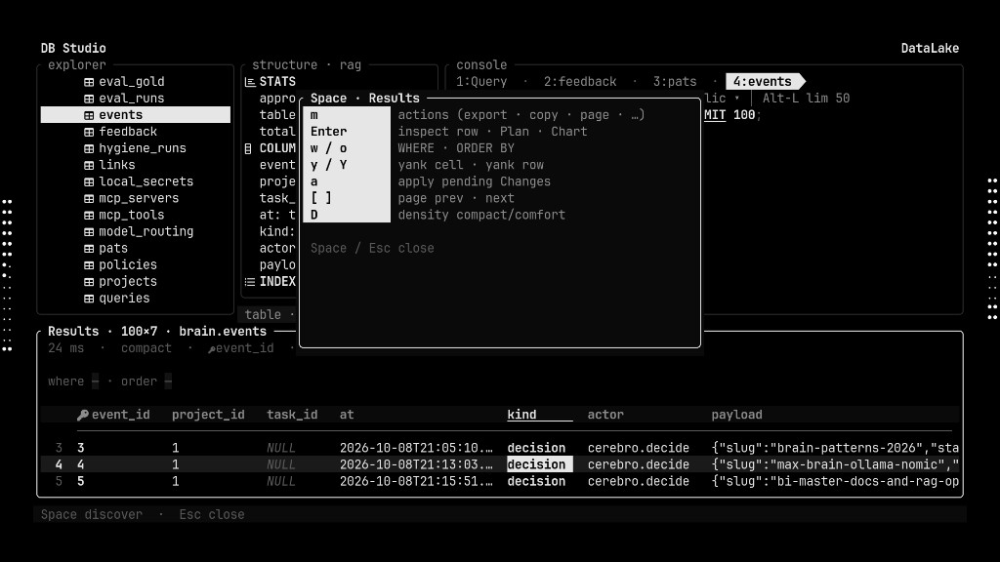

# DB Studio

**The keyboard-first Database IDE for DBAs and data engineers.**  
A truecolor terminal studio — Explorer · Structure · Console · Results — that stays fast over SSH, respects your muscle memory, and never forces a heavyweight desktop IDE.

[](https://github.com/tobbikz/db-studio/releases)
[](LICENSE)

**v0.5.0** · Linux & Windows · Postgres · MySQL · MSSQL · SQLite · DuckDB · ClickHouse · Redis · Mongo · Snowflake · BigQuery · Elasticsearch · Trino

---

<p align="center">
  
</p>

<p align="center"><em>Results grid — compact density, WHERE/ORDER wells, cell hover preview, keyboard footer. Built for people who live in SQL.</em></p>

---

## Why DB Studio (and why desktop IDEs feel slow)

We built DB Studio for the DBA who already lives in a terminal — SSH jump boxes, bastions, tmux, Neovim muscle memory — and refuses to wait on Electron chrome or a JetBrains license just to peek at a table.

| | **DB Studio** | Typical desktop IDE (e.g. DataGrip) |
|--|--|--|
| **Latency feel** | Instant TUI redraw; runs great over SSH | Heavy GUI; painful on high-latency links |
| **Input model** | Keyboard-first (`Ctrl-P`, `Space` discover, vim-ish normals) | Mouse + menus first |
| **Footprint** | Single Rust binary | Multi-GB IDE + JVM |
| **Themes** | AMOLED mono, Nord, Mocha, Tokyo, Dracula, Light, **custom TOML** | Skins, but not terminal-native |
| **Remote** | Same UX on bastion as on laptop | Remote Desktop / tunnel gymnastics |
| **Grid editing** | Inline edit → SQL preview → Apply | Strong — we match the *workflow*, without the bloat |
| **Ops** | Health, EXPLAIN visuals, dump/restore, migrations | Excellent — we cover the daily 80% in-terminal |

**Honest take:** DataGrip is a fantastic product. For day-to-day DBA work on a bastion — inspect, filter, edit a cell, EXPLAIN, export, switch connections — **DB Studio is the tool you keep open**. No splash screen. No project wizard. Open → connect → query.

---

## Screenshots

### Results — the grid you stare at all day

<p align="center">
  
</p>

- Quiet meta chips (`100×17 · compact · 40 ms · table · PK · page · lim`)
- `WHERE` / `ORDER BY` wells with column suggest
- Soft selection (no white-wash), pin columns, density toggle
- Fullscreen (`f`) when you need the whole terminal

### Inline edit & WHERE suggest

<p align="center">
  
</p>

### Console — SQL with air

<p align="center">
  
</p>

- Multi-tab SQL (`Ctrl-W` close · `Ctrl-P` palette)
- Chip toolbar: ▶ F5 · database ▾ · schema ▾ · lim
- Accent gutter bar on the cursor line · truecolor SQL syntax

### Themes — live preview like DataRig

<p align="center">
  
</p>

↑↓ previews · Enter keeps · Esc restores · custom TOML under `~/.config/tui-ide/themes/`

### Space discover

<p align="center">
  
</p>

Press **Space** — see what can follow. No memorization tax.

---

## Feature map

### Studio layout
- **Home** — Sources · Recents · Favorites · health
- **Explorer** — tree, accents, RO/role marks, DDL, create menu
- **Structure** — follows Console `FROM` / Explorer selection
- **Console** — multi-tab SQL, completions, EXPLAIN, lim 50 default
- **Results** — grid, paging, filter, density, inspect, charts

### Query & edit
- Run / cancel · EXPLAIN with timeline / icicle / funnel visuals
- Cell / Row / Plan / Chart inspector
- Inline cell edit · pending Changes SQL preview before Apply
- Insert / delete rows · NULL toggle · yank cell/row · paste TSV
- Transactions · kill session · bookmarks · query history

### DBA / ops
- Connection health · Admin / Health overview & activity (incl. MSSQL packs)
- Dump / restore · schema diff · data compare · migrations
- Vacuum / analyze / reindex · privileges · RLS policies (Postgres)
- Export CSV / SQL / JSON / Markdown · result packs
- Import CSV / JSON · ER sketch / canvas · CDC lag sketch

### Platform
- Drivers: **PostgreSQL, MySQL, MSSQL, SQLite, DuckDB, ClickHouse, Redis, MongoDB, Snowflake, BigQuery, Elasticsearch, Trino**
- SSH jump on connections · `env:VAR` / vault passwords · connection packs
- Roles: viewer / editor / admin · PROD/STG/DEV marks from connection name
- Themes: AMOLED mono · AMOLED light mono · Dark · Nord · Mocha · Tokyo Night · Dracula · Light · High contrast · **custom**
- Agents / Sessions / Terminal surfaces for adjacent workflows

Full inventory: **[docs/FEATURES.md](docs/FEATURES.md)** · Themes: **[docs/THEMES.md](docs/THEMES.md)**

---

## Install

| OS | Install | Update |
|----|---------|--------|
| **Linux** | `./scripts/install.sh` → `~/.local/bin/db-studio` | `./scripts/update.sh` |
| **Windows** | `.\scripts\install.ps1` → `%LOCALAPPDATA%\db-studio\` | `.\scripts\update.ps1` |

Needs [Rust](https://rustup.rs/) 1.75+. Details: **[docs/INSTALL.md](docs/INSTALL.md)**.

```bash
git clone https://github.com/tobbikz/db-studio.git && cd db-studio
./scripts/install.sh
db-studio
```

```powershell
git clone https://github.com/tobbikz/db-studio.git
cd db-studio
.\scripts\install.ps1
db-studio
```

---

## Essential keys

| Key | Action |
|-----|--------|
| `Ctrl-P` | Command palette |
| `Space` | Discover next keys |
| `Ctrl-W` | Close SQL tab |
| `Shift-T` | Cycle theme |
| `1`–`4` | Explorer · Structure · Console · Results |
| `Tab` | Cycle panes |
| `F5` / `Ctrl-↵` | Run SQL |
| `Enter` | Inspect (Results) / open (Explorer) |
| `w` / `o` | WHERE / ORDER BY |
| `m` | Results actions |
| `?` | Help |
| `Esc` | Back / Home / cancel |

---

## Config

`~/.config/tui-ide/` (Linux) · `%APPDATA%\tui-ide\` (Windows)

Connections, `config.toml` (`theme.name = "dark"`), custom themes in `themes/*.toml`.

---

## Docs

| Doc | |
|-----|--|
| [docs/FEATURES.md](docs/FEATURES.md) | Complete feature inventory |
| [docs/INSTALL.md](docs/INSTALL.md) | Linux / Windows install & update |
| [docs/THEMES.md](docs/THEMES.md) | Built-ins + custom TOML |
| [docs/AGENTS.md](docs/AGENTS.md) | Agents surface |
| [docs/SESSIONS.md](docs/SESSIONS.md) | Sessions |

---

## License

Apache-2.0 · [Releases](https://github.com/tobbikz/db-studio/releases)
