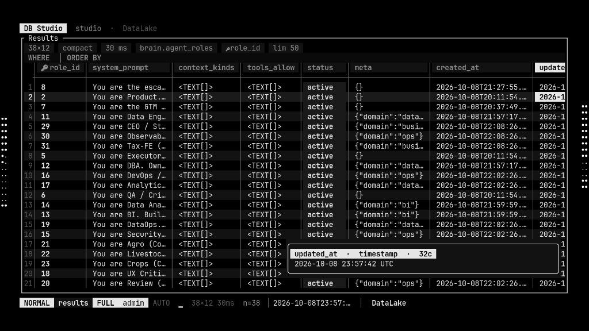
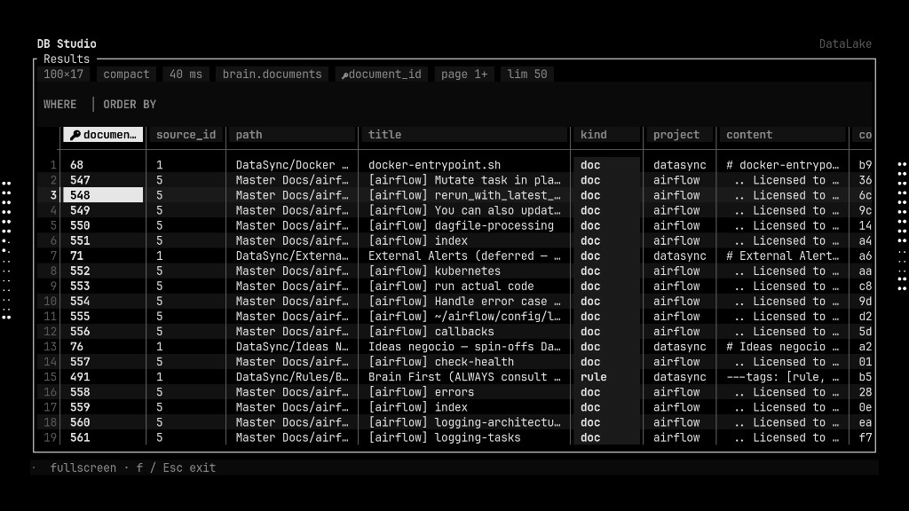
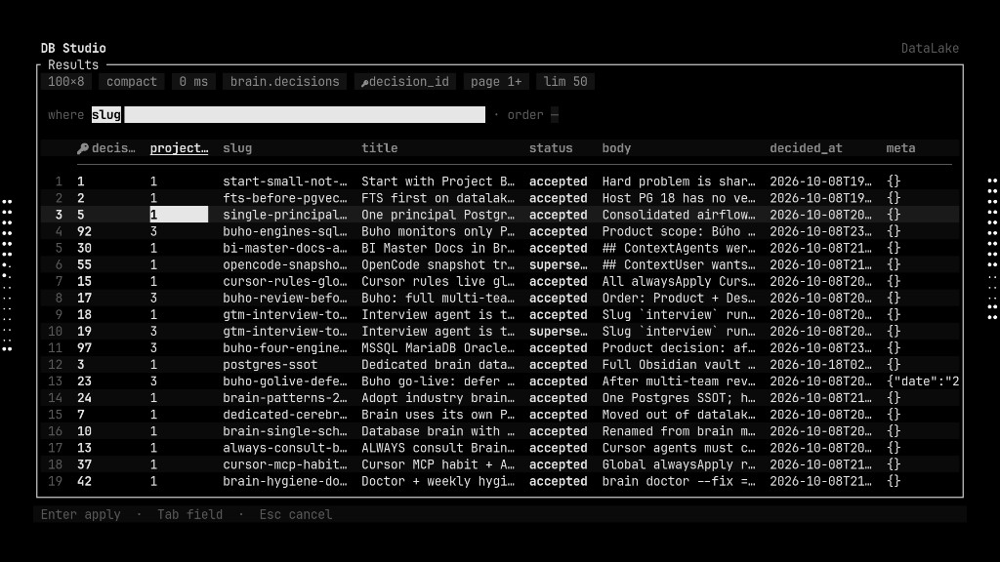
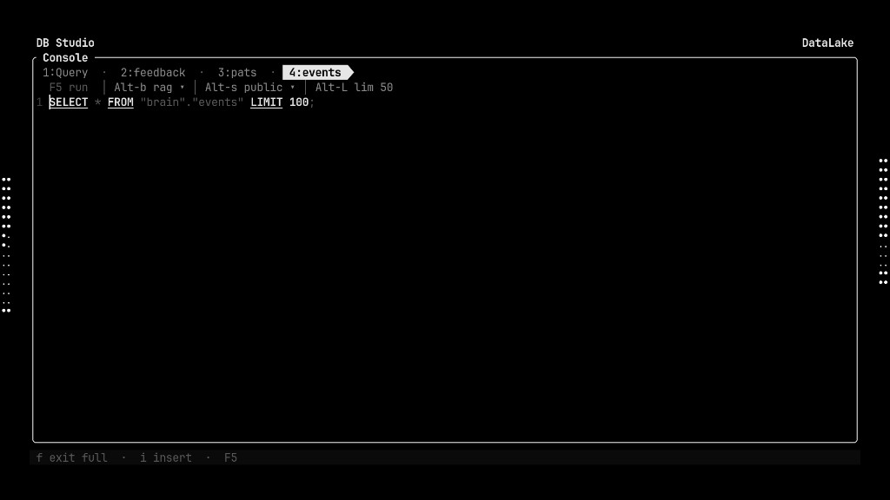
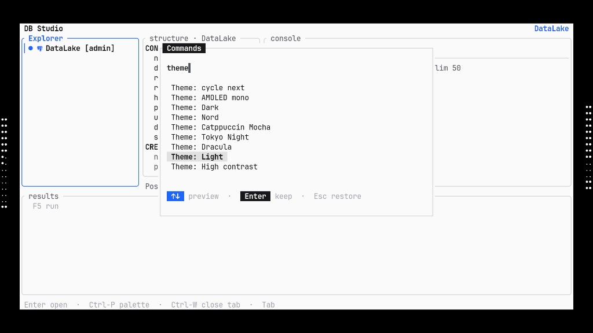
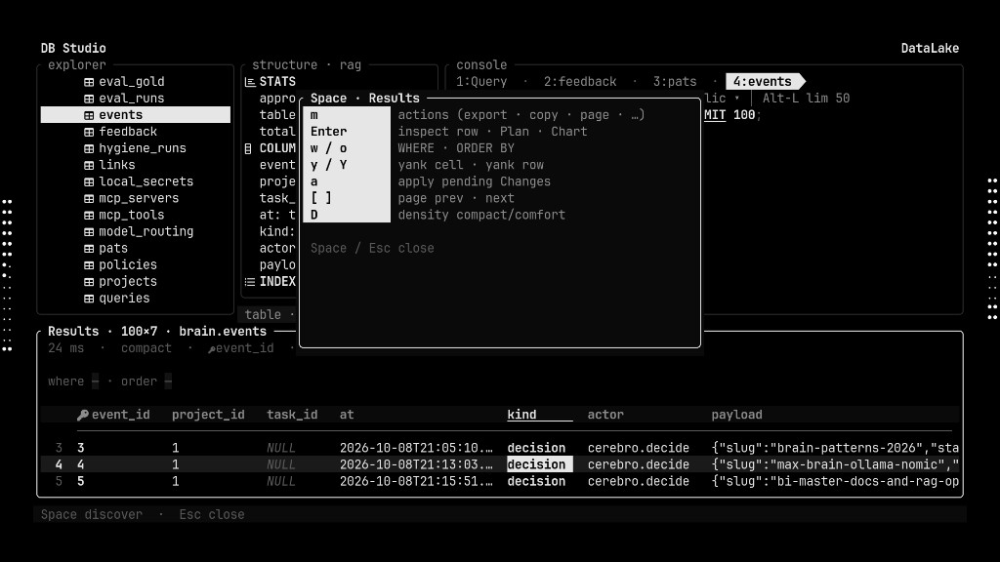

# Feature inventory — DB Studio

Complete map of what ships in **v0.5.0**. Companion to the [README](../README.md).

  

---

## Positioning

DB Studio is a **keyboard-first Database IDE in the terminal** for DBAs, SREs, and data engineers who:

- Work over **SSH / bastions / tmux** where Electron IDEs crawl
- Want **Explorer → Structure → Console → Results** without leaving the keyboard
- Need **inline grid edit → SQL preview → Apply**, EXPLAIN visuals, dump/restore, and multi-engine drivers in one binary

Desktop IDEs (DataGrip, DBeaver, Azure Data Studio, …) remain excellent for heavy GUI modeling and some enterprise connectors. For the daily DBA loop — connect, browse, filter, edit, explain, export — **DB Studio is designed to feel faster and lighter**, especially remote.

---

## Studio surfaces

| Surface | What you get |
|---------|----------------|
| **Home** | Sources, Recents, Favorites, connection health |
| **Explorer** | Object tree, accents, RO/role marks, DDL, create/drop/alter menus |
| **Structure** | Columns / keys / indexes for Console `FROM` or Explorer selection |
| **Console** | Multi-tab SQL, syntax, completions, lim, database/schema chips |
| **Results** | Grid, WHERE/ORDER, density, paging, inspect, charts, edits |
| **Agents** | Recipe / dbt / ask→SQL adjacent workflows — [AGENTS.md](AGENTS.md) |
| **Sessions** | Session list / attach — [SESSIONS.md](SESSIONS.md) |
| **Terminal** | Embedded shell when you need it |

---

## Results (DataRig-class grid)

  

- Meta chips: shape · density · latency · table · PK · page · limit  
- **WHERE** / **ORDER BY** wells with column suggest  
- Soft row/cell selection (no white-wash) · pin columns · compact / comfortable  
- Fullscreen (`f`) · cell hover / wide-cell / blob viewer  
- Quality strip (null% / stats) · optional PII mask  
- Charts: bar · line · pie from current result  
- Export: CSV · SQL INSERTs · JSON · Markdown · result pack (SQL+CSV)  
- Import / paste TSV into grid  
- Golden CSV diff · fan-out rowcount assert  

### Editing

- Inline cell edit · undo · toggle NULL  
- Insert / delete row  
- **Pending Changes** SQL preview before Apply  
- Apply row updates as a transaction when supported  

  

---

## Console & SQL

  

- Multi-tab SQL · pin · rename · close (`Ctrl-W`) · new tab  
- Run / cancel · lim default 50 · database / schema chips  
- Format SQL · bookmarks · query history palette  
- Completions / object search everywhere  
- Fan-out SQL to pinned ★ connections  
- Transactions · kill session (where driver allows)  

---

## EXPLAIN & plans

- Explain SQL from Console / palette  
- Cost / bytes summary  
- Visual plan surfaces (timeline / icicle / funnel style views in inspector)  
- Cell / Row / Plan / Chart inspector panes  

---

## Explorer & DDL

- Tree navigation with keyboard  
- Soft selection accent (`▎` + surface)  
- Open table → Results · copy DDL  
- DROP / TRUNCATE table (confirm)  
- ALTER ADD / DROP / RENAME column  
- Schema diff → migration file  
- ER sketch / canvas · column lineage sketch  

---

## Migrations & schema ops

- Dry-run migration file  
- Apply migration file  
- Migration status  
- Rollback last migration  
- Schema ADR stub note  
- Naming hint (logical → physical)  

---

## Connections & security

- Drivers: **PostgreSQL · MySQL · MSSQL · SQLite · DuckDB · ClickHouse · Redis · MongoDB · Snowflake · BigQuery · Elasticsearch · Trino**  
- SSH jump on connections  
- Passwords via `env:VAR` / vault-style refs  
- Connection packs · import/export · **signed** pack export  
- Find connection · roles: viewer / editor / admin  
- PROD / STG / DEV marks from connection naming  
- Privilege audit · export audit log CSV  
- RLS policy helpers (Postgres)  
- Diagnose pack for support  

---

## Health & admin

- Connection health overview / activity packs (incl. MSSQL)  
- Vacuum / analyze / reindex (Postgres-oriented)  
- CDC / replication lag sketch  
- Health webhook test  
- Dump / restore workflows  
- Data compare  

---

## Themes & UX chrome

  

Built-ins: AMOLED mono · AMOLED light mono · Dark · Nord · Mocha · Tokyo Night · Dracula · Light · High contrast  

- Live preview in palette (↑↓) · Enter keep · Esc restore  
- **Shift-T** cycle · custom TOML under `themes/` — [THEMES.md](THEMES.md)  
- **Space** discover overlay — next keys without memorizing  
- **Ctrl-P** command palette (fuzzy)  
- Onboarding tips · recipe gallery  

  

---

## Recipes & data workflows

Palette recipes (seed / gallery):

- Top customers · revenue by day · stratified sample  
- Embedding similarity · feature table · batch score  

### dbt / BI / ML bridges

- dbt detect · run · test · compile · schema.yml stubs  
- Airflow DAG deep-link  
- BI deep-link (Superset / Metabase) · BI export CSV path  
- Model registry deep-link  
- Agents: ask→SQL preset seed  

### Codegen & fixtures

- Codegen Rust struct · TypeScript interface  
- Seed fixtures from `testdata/`  

---

## Platform

| | |
|--|--|
| **Binary** | Rust · `db-studio` |
| **OS** | Linux · Windows ([INSTALL.md](INSTALL.md)) |
| **Config** | `~/.config/tui-ide/` · `%APPDATA%\tui-ide\` |
| **License** | Apache-2.0 |
| **Release** | [v0.5.0](https://github.com/tobbikz/db-studio/releases/tag/v0.5.0) |

---

## Essential keys (cheat sheet)

| Key | Action |
|-----|--------|
| `Ctrl-P` | Command palette |
| `Space` | Discover |
| `Ctrl-W` | Close SQL tab |
| `Shift-T` | Cycle theme |
| `1`–`4` | Explorer · Structure · Console · Results |
| `Tab` | Cycle panes |
| `F5` / `Ctrl-↵` | Run |
| `Enter` | Inspect / open |
| `w` / `o` | WHERE / ORDER |
| `m` | Results actions |
| `f` | Fullscreen Results |
| `?` | Help |
| `Esc` | Back / cancel |

---

## Screenshots index

| File | Shows |
|------|--------|
| `assets/hero-results-hover.png` | Hover preview on Results |
| `assets/results-grid.png` | Full Results grid |
| `assets/results-where-edit.png` | WHERE well editing |
| `assets/results-fullscreen.png` | Fullscreen Results |
| `assets/studio-console.png` | Console + tabs |
| `assets/studio-results-discover.png` | Space discover |
| `assets/studio-tabs.png` | Tab chrome |
| `assets/theme-light-preview.png` | Theme preview |
| `assets/theme-palette.png` | Theme palette list |
