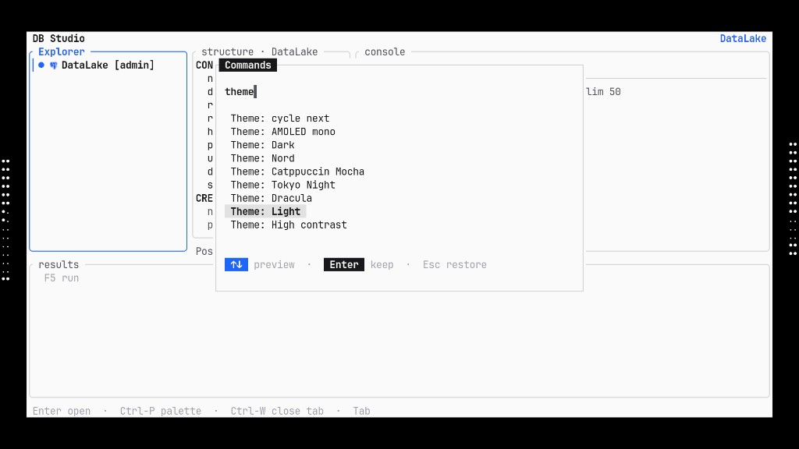

# Themes — DB Studio

<p align="center">
  
</p>

Built-ins (palette: `Ctrl-P` → type `theme`):

| Id | Label |
|----|--------|
| `black` | AMOLED mono |
| `white` | AMOLED light mono |
| `dark` | Dark (default) |
| `nord` | Nord |
| `catppuccin-mocha` | Catppuccin Mocha |
| `tokyo-night` | Tokyo Night |
| `dracula` | Dracula |
| `light` | Light (accent blue) |
| `high-contrast` | High contrast |

- **↑↓** in the palette live-previews a theme  
- **Enter** keeps it (writes `theme.name` in config)  
- **Esc** restores the previous theme  
- **Shift-T** cycles built-ins + customs  

## Custom themes

1. Palette → **Theme: new custom…**  
   or create `~/.config/tui-ide/themes/mytheme.toml` (Windows: `%APPDATA%\tui-ide\themes\`).

2. Edit colours (hex `#rrggbb`). Example:

```toml
extends = "dark"
label = "Ocean"

[colors]
accent = "#89b4fa"
bg = "#0b1220"
fg = "#cdd6f4"
surface = "#111827"
border_focus = "#89b4fa"
syn_keyword = "#cba6f7"
syn_string = "#a6e3a1"
```

3. Palette → **Theme: reload customs**, then pick **Theme: Ocean (custom)**.

`extends` must be a built-in id. Unknown colour keys are ignored; bad files log to stderr and fall back.

Config:

```toml
[theme]
name = "mytheme"
```
